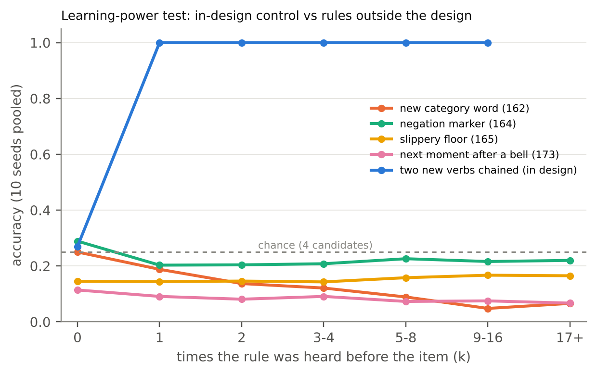
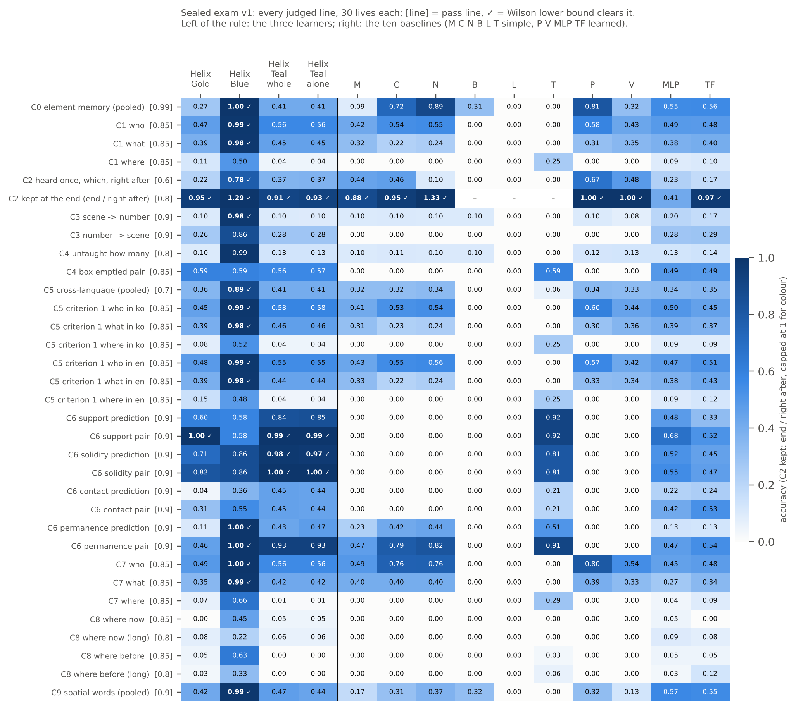
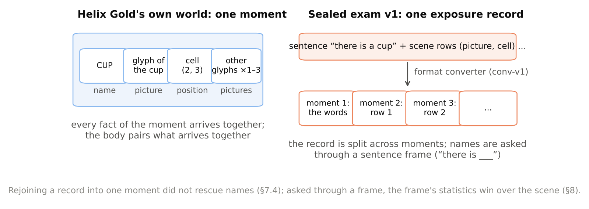

# Learning from Its Own Input: A Small Self-Tuning Learner, Its Infant-Inspired Logic, and a Sealed Exam

**isolesta-hue** (Independent Researcher)

Version 1.0 — 2026-10-23. Numbers are copied from pre-registered runs; each is traced to its record in Appendix D. Written with AI assistance (see the Authorship and AI-use statement).

## Abstract

Infants first keep what they hear and see, then try to produce the same thing from memory and correct themselves until it matches: for this internal imitation the input is its own answer. We built a small learner, Helix Gold, around that idea and asked whether such a closed system can also improve *how* it learns. It memorises every element of its input once, before any use, and never changes it afterwards (input = answer); its "body" pairs whatever arrives together in one moment, without outside feedback; and a method layer tunes the learner's own learning from tests the learner makes for itself, keeping a change only when it does better — a small closed self-improvement loop. On top of this we gave it logic borrowed from how infants come to understand the world. In its own world — a 5 × 5 coordinate grid centred on the self, with glyph pictures, where every fact arrives inside one moment — we measured what each piece of logic contributes by switching it off (pre-registered; 30 seeds each; paired sign tests 30:0):

- an explicit world-model state, rolled forward by motion "books" that the learner reads off its own first-hand moments, chains two motions never heard together (0.04 → 0.90);
- a context book carries a room's inversion to verbs never heard in that room (0.02 → 0.92);
- per-object state tracking follows multi-moment stories (0.34 → 1.00);
- a self-check by re-reading lifts the body's own speech (0.45 → 1.00).

The self-improving loop met its pre-registered completion criterion: the self-tuned learner ends ahead of the fixed one (+0.050) by a margin that grows over the life (100 seeds). But that effect is small next to the designed logic. Rules outside the design — a new category, a negation marker, a new causal rule, a new order rule — were not learned at all.

We then took a shared, sealed exam with three independently built learners. The exam has ten criteria with pass lines fixed in advance, ten baselines, and keys sealed outside every repository until all answers were in. Through a format converter, Helix Gold's general body passed 0 of 10 criteria. It beat all ten baselines on exactly one group, a physical-support judgement. Its name items scored 0.000–0.056 against a chance level of 0.038. One sibling learner passed 3 of 10 by the grader's lines; under the full judgement none of the three is yet a complete pass.

Everything Helix Gold got right had its fact inside one moment of the converted input, and the converter had split each exposure record — a sentence and the scene it describes — into separate moments. A pre-registered diagnosis rejoined each record into one unit: names stayed near chance (0.026 → 0.073, not significant), so the split is not their cause. In its own world the same body learns new names across situations — scenes with one to three other pictures, tested in fresh scenes (0.26 after one hearing, 0.70 after eight). What differs in the exam is how names are asked: through a sentence frame ("there is ___") whose statistics favour common words, and for persons a frame never heard with a person at all. This reading has since been measured, as a diagnosis, in two learners: in Helix Gold's own world new names drop from 0.284 to 0.111 when asked inside a frame never heard with names (10 seeds, 10:0), and in Helix Teal's exam lives asking Korean names in their heard form raises them from 0.021 to 0.260 (4 lives). We report the protocol, the results and the diagnosis as an honest case of non-transfer.

## 1. Introduction

The project started from an observation about infants. A baby first keeps what it hears and sees, then tries to produce the same thing from memory, and corrects itself until its output matches the input: in this internal imitation the input is its own answer. Standard supervised learning pairs each input with a separate answer, and a language model learns to give probable continuations; neither first stores the input itself and rebuilds it as its own answer before using it. We asked what happens when a small learner is built around internal imitation, and whether, closed off from new outside supervision, it can then improve *how* it learns — not only *what* it knows — so that a self-modified version pulls ahead of a fixed one by a margin that keeps growing. We fixed that completion criterion before measuring it (§5). Along the way, most of the large gains came from something else: logic we borrowed from infant learning and designed into the learner, especially a world model built on a coordinate grid centred on the self. We measured each piece of that logic by switching it off; the switching is how we know what each piece does, not the subject itself.

That raised a second question, more important for the field than the first. **Does such designed logic carry over when the same learner faces material it was not built around?** To answer it without our own bias, three learners built by separate sessions took the same sealed exam on the same day. The exam had pass lines fixed beforehand, keys sealed until every answer was in, and simple and learned baselines.

This paper reports both answers. Our contributions:

1. **A learner built on internal imitation, and infant-inspired logic with measured value** (§3–4). Memory first (input = answer), connections without feedback, a closed loop on how to learn; a coordinate-grid glyph world and a world-model layer whose "books" are read off the learner's own first-hand moments. For each piece of logic we say where the idea comes from, measure its contribution by switching it off (pre-registered), and state which part a human designed.
2. **The starting question, answered** (§5). The closed loop meets its completion criterion, and its margin grows in harder worlds. The effect is small next to the designed logic, and rules outside the design are not learned (a learning-power test with in-design controls).
3. **A sealed-exam protocol for comparing small learners** (§6). The seed phrase is given on the day, keys are sealed and later published, anyone can regenerate the edition from the phrase, all ten baselines run on the same items, and time is recorded.
4. **An honest non-transfer result with a diagnosis** (§7). Each failure is read converter-first. A per-part probe shows what answered. A converter-variant diagnosis tests — and rejects — the most obvious explanation, a structural boundary in the input. The reading that remains — a sentence frame outvotes the scene — is measured as a diagnosis in two learners (§8).

## 2. Related work

*Word learning from co-occurrence.* Cross-situational learning pairs words and referents across scenes (Siskind 1996; Yu & Smith 2007). Pursuit (Stevens et al. 2017) and propose-but-verify (Trueswell et al. 2013) are single-hypothesis alternatives; both appear among our baselines. Fast mapping (Carey & Bartlett 1978) and the shape bias (Landau, Smith & Jones 1988) frame our naming and category tests.

*Core knowledge and violation of expectation.* Our physical criteria (support, solidity, contact, permanence) follow the infant looking-time paradigm (Baillargeon 1987; Spelke & Kinzler 2007). The learner "looks longer" when its scene likelihood is low.

*World models.* Learned world models usually compress observations into a latent state for prediction or planning (Ha & Schmidhuber 2018). Ours is the opposite extreme: an explicit, symbolic-coordinate state whose transition entries are read directly from the learner's own memory. It is closer to the "start-up software" view of Lake et al. (2017).

*Self-improvement.* Self-referential learners (Schmidhuber 2003) and hyperparameter search with early stopping (Li et al. 2018) supply the method layer's ingredients. We study the small, closed, measurable case.

*Frames and words.* Syntactic bootstrapping holds that a sentence frame tells a child what kind of word fills a slot (Gleitman 1990); which word it is comes from the scene. Our main reading (§8) is a failure of exactly that division. Word–referent learning from one child's view has been shown in a neural network (Vong et al. 2024), a natural comparison for small grounded learners.

*Neural baselines.* Our learned baselines MLP and TF, and Helix Teal's body, are masked-token predictors in the transformer line (Vaswani et al. 2017; Devlin et al. 2019); the BabyLM challenge (Warstadt et al. 2023) is the closest benchmark for small-data developmental language models.

*Evaluation.* Pre-registration (Nosek et al. 2018), sealed test sets and Wilson intervals (Wilson 1927) shape our protocol. We add a regeneration check: the published seed phrase reproduces every file hash of the edition.

*Memory for order.* In the temporal context model, an item is stored with the slowly drifting context of its moment, so order lives in the stamps rather than in the items (Howard & Kahana 2002); complementary learning systems keep fast episodic memory apart from slowly learned patterns (McClelland, McNaughton & O'Reilly 1995). Our order device (§9) follows both ideas in a simple form.

*Interference.* Catastrophic interference (McCloskey & Cohen 1989) and the stability–plasticity dilemma (Mermillod, Bugaiska & Bonin 2013) frame two of our negative results.

## 3. The learner

**Design principles** (from the project's first design, kept since).
- *Internal imitation, memory first.* Every element is stored once and reconstructed from its own code before it is used; the input is its own answer, and no later learning changes a stored code (§3.1).
- *Connections without feedback.* The body pairs what arrives together in a moment (§3.2).
- *Feedback learning starts from that memory, not from random values,* and its answers are split into parts whose shares can be read.
- *A closed loop on how to learn.* The method layer tries changes on copies and keeps one only when the learner's own test says it does better; the kept copy is the fallback (§3.3).
- *Infants are a source of ideas, not a template.* An infant mechanism is borrowed only after asking why infants have it and whether that reason holds for a machine; where it does not, the idea is changed to fit.

### 3.1 Element memory
Every input token is an *element* with a raw feature vector. Module A memorises each element once, before any learning: a fixed decoder is frozen at creation, and each element's latent code is found by gradient descent against that decoder. Stored codes never change afterwards. A "self" anchor sits at the origin of the code space. For the exam's roughly 4,000 elements per life, Module A rehearses until every element is recalled. Recall reaches 0.9998, so memory is not the bottleneck in anything below.

### 3.2 The body
The body learns from **moments**: the tokens that arrived together, treated as a bag. Its answer to a fill-in item is a sum of exactly separable parts (the split is exact to 1e-5):
- a **habit** part: standardised context similarity plus a connection table of co-occurrence within moments;
- **templates**: relation templates kept only when they compress;
- **whole-sentence memory** (*chunk*), weighted by rarity;
- a **side** part trained on self-made recombinations.

A kind gate keeps answers of the asked kind. Two properties matter later:
- **(i) the body pairs elements only inside a moment;**
- **(ii) it has no order across the moments of a session.**

### 3.3 The method layer
Each session, the method layer turns knobs: review ratio, learning rate, order and review selection. It does so by branching: one-step changes, trained 50 → 100 → 200 epochs, keeping the better half each round. It chooses a branch by a *self-made yardstick*: new-combination problems the learner composes from its own record, never the outside test. In later versions it also runs *self-experiments*, computing "what if this part weighed w×?" without relearning, which the exact split allows.

## 4. The coordinate-grid glyph world and its infant-inspired logic

### 4.1 The world
Positions are tokens `pos(x, y)` on a 5 × 5 grid *relative to the self* — the learner's own position (the token for it is named `na`, Korean for "I", in the code) — with x, y ∈ −2..2. Their features are linear in (x, y), so a one-cell move is a constant offset in feature space, and a motion verb *is* a relation template. The grid is coarse on purpose: Module A recognised every 5 × 5 position but only 60–98% of the cells of a 9 × 9 grid, so finer grids wait for a finer memory.

Objects are 5 × 5 glyph sprites. A fixed random "retina" turns each sprite into the object's picture features, so similar sprites get close features.

A life passes through rooms. Each room brings four new objects and two kinds of moments:
- **naming moments** (picture, name, place);
- **motion moments** (picture, verb, from-position, to-position).

Later phases add a new verb and then upside-down rooms. **Every fact the learner meets arrives inside a single moment.**

### 4.2 The world-model layer
**Books.** For each motion word, the move = memory[to] − memory[from], read from the learner's own first-hand moments in its fixed original memory. Coinciding moves are merged with counts, and confirmed per room.

**Rollout.** For a question with a start position and two or more motion words, the state starts at the start position. Each book's pure move (with the role shift removed) is added in turn.

**Answer part.** If the state lands within half a cell of a cell, that cell receives evidence of one template unit per book used. This is added as its own part, so the split stays exact. Later, a confident world model speaks last (`+wmlast`): a decided rollout places its cell above the other parts.

Extensions follow the same pattern:
- **context book** (`+wmctx`): a room whose heard verbs all move against the usual books is read as "this room inverts every move", and unheard verbs are inverted too;
- **per-object state** (`+track`);
- **the book read backwards** for describing (`+wmrev`);
- **re-reading** before speaking (`+speak mon`; the self-monitoring loop of Levelt 1989);
- **object properties** (`+props`);
- **"repeat until blocked"** words (`+grav`);
- **a number line placed in the same coordinates.**

**Where the ideas come from.** Motion meanings are read off what the learner itself saw happen, not given as definitions (books). Space is coded from the self outwards, the self at the origin (the grid). Things go on existing and moving when out of sight (per-object state; object permanence, Baillargeon 1987). Speech is checked before it is said (re-reading; Levelt 1989). A rule can hold in one place and not another (the context book). In each case the infant idea gives the *shape* of the logic; what fills it is learned from the learner's own record (below).

### 4.3 What each piece of logic contributes — measured by switching it off (pre-registered, paired sign tests over seeds)

| Logic (finding) | Test | Without | With | Seeds (wins) |
|---|---|---|---|---|
| World-model rollout (120) | two motions never heard together | 0.036 | 0.902 | 30 (30:0) |
| Context book (122) | unheard verb in an inverted room | 0.022 | 0.917 | 30 (30:0) |
| Particle binding (123) → confident world model last (125) | Korean particle stories → scene | 0.072 → 0.407 | 1.000 | 30 (30:0 each) |
| Per-object state (126) | multi-moment stories, "where now" | 0.344 | 1.000 | 30 (30:0) |
| — same (126) | object-permanence violation | 0.378 | 1.000 | 30 (30:0) |
| Book read backwards (127) | describe a seen motion | 0.301 (body) | 1.000 | 30 (30:0) |
| Re-reading before speaking (128) | scene → one Korean sentence | 0.45 (body) | 1.00 | 30 (30:0) |
| Object properties (129) | collisions | 0.500 | 1.000 | 30 (30:0) |
| Repeat-until-blocked (130) | falls to the floor / onto an object | 0.275 / 0.604 | 1.000 / 1.000 | 10 (10:0) |
| Number line, same coordinates (136) | addition to unheard results; subtraction with a word never heard on the line | 0.000 / 0.035 (body / other spacing) | 1.000 / 1.000 | 10 (10:0) |
| Counting part (155) | objects → number word 1–10 | 0.133 (body) | 1.000 | 10 (10:0) |

**What is designed and what is learned (human share).**
- **Designed by us:** the *shape* of each rule — a move is an offset; "repeat until blocked"; a room may invert all moves; a property table with two values.
- **Learned by the learner from its own record:** *which* word maps to which move, which word repeats, which particle marks the start, which room inverts.

Each mechanism is close to useless without its designed shape. The body alone stays near chance on every row above.

**Cost of designed parts.** Switching on every part, including parts for subjects absent from a world, hurts badly (finding 159; 3 seeds, a direction only):
- 48 of 167 measures drop in one world;
- counting falls 1.000 → 0.216.

The parts have no way to know "this is not my world", and once switched on they always speak.

## 5. The closed self-improvement loop: the question and its answer

**Completion criterion** (fixed before measuring): on the same data, the learner with the self-tuning method layer must beat the same learner with fixed settings at the end of life, and the gap must widen across sessions (100 seeds).

- **Met in the frame world** (finding 69): +0.050 at the end of life (78:21). The gap widens session by session: +0.009 → +0.011 → +0.015 → +0.029 → +0.034 → +0.043 → +0.050 (sessions 6–8 minus 2–4: +0.031, 74:26).
- **The margin keeps widening in a harder world.** In a world ladder where half the side words become shared by all topics (finding 111; 100 seeds), the end gap is +0.143 (99:1) and late widening +0.033 (78:22).
- **Self-experiments help in harder worlds.** Choosing part weights by self-experiment beats knobs-only by +0.050 at the end (finding 115; 25:5, p = 0.0003).

**Limits.**
- The knobs were chosen by us.
- In the glyph world the body gives the method layer little leverage. Early in life, the outside test barely ranks branches consistently (reliability 0.10–0.22; finding 100), so any knob choice gives practically the same result.

**Learning-power test** (findings 162–165 and 173; pre-registered; code frozen while measuring). New rules no part was designed for were put into the world, and learning curves were measured against an in-design control:

| Subject | Kind | End accuracy | Chance | Verdict |
|---|---|---|---|---|
| New category word per shape family (162) | out of design | 0.106 | 0.25 | not learned — goes *below* chance with hearing (0:10) |
| Negation marker (164) | out of design | 0.201 | ≈ 0.25 | not learned |
| Slippery floor doubles a move (165) | out of design (new causal rule) | 0.128 | ≈ 0.25 | not learned |
| After a bell, the next moment the thing moves one up (173) | out of design (new order rule; measured with the order device of §9) | 0.079 | 0.25 | not learned — flat, about two thirds of items abstain |
| Two new verbs chained (164) | in design (books) | 1.000 from the first hearing | — | learned |

*Figure 1. Learning-power test (findings 162–165, 173): accuracy by how often the rule was heard before the item, 10 seeds pooled. The in-design control (two new verbs chained) is at 1.000 from the first hearing; the four rules outside the design stay at or below chance.*

Design reliance (in-design minus out-of-design, 1 ≤ k ≤ 8 hearings) is +0.79 to +0.92 (10:0). Subjects 2 and 3 moved none of 57 other measured keys; subject 1 lowered three by about 0.05; subject 4 lowered six, among them describing a scene with its motion word (−0.14), likely through the rule's bell-less contrast moves, which add verbless moves to the life. The order rule was fixed before the order device existed; the device answered no item differently (0 of 612 values), because it speaks only for a question with one picture whose question word it has learned, and no subject item is of that kind.

**Answer to the starting question.** A small closed loop *can* improve how it learns by a measurable and growing margin. In this learner, though, the large gains came from designed logic, and the learner does not yet learn new rule *shapes*.

## 6. The sealed exam (method)

### 6.1 Edition and criteria
A shared generator (gen-v1) builds, from a seed, 30 "lives". Each life has three parts:
- an exposure stream of 16 sessions (1,752–1,933 records per life); each record is a sentence in Korean or an English-like language, plus the scene it describes on a 5 × 5 grid;
- 616–632 items, answered after their sessions (8,656–8,912 answer rows per life);
- a key file.

Ten core criteria have pass lines fixed by the three sessions and approved by the owner before any edition existed:

| | Criterion | Pass line (Wilson 95% lower bound) |
|---|---|---|
| C0 | element memory (names, particles) | ≥ 0.99 |
| C1 | new combinations: who, what, where | ≥ 0.85 each |
| C2 | a word heard once ("which", right after) | ≥ 0.60; kept at the end ≥ 0.80 of right-after |
| C3 | scene → number, number → scene (1–10) | ≥ 0.90; no n below 0.70 |
| C4 | untaught "how many" after put/take; emptied-box pair | ≥ 0.80; ≥ 0.85 (judged only if C3 passes) |
| C5 | C1 in each language; cross-language questions | C1 lines per language; ≥ 0.70 |
| C6 | support, solidity, contact, permanence (prediction and pair) | ≥ 0.90 each |
| C7 | story who, what, where ("when" reported only in v1) | ≥ 0.85 each |
| C8 | where now / where before (normal and long stories) | ≥ 0.85; long ≥ 0.80 |
| C9 | spatial words | ≥ 0.90 |

One depth of the edition was found only after grading (Helix Blue's later check): half of the support items (360 of 720) have two objects falling together, a depth never shown in the exposure (one object falls in all 674 such exposure moments).

A criterion passes when all its lines pass. The full judgement also asks two more things:
- **(b)** a per-life paired sign test against each baseline, p < 0.005;
- **(c)** an answer-shuffle control that collapses.

### 6.2 Protocol
1. The generator, grader, pass lines and baseline runners were fixed by hash before the opening. Each session also declared, before the opening, the body, converter and runner (with fingerprints) it would answer with.
2. On the opening day (2026-10-19, 03:00 UTC) the owner gave a seed phrase. The edition was generated and published without its keys; the keys were sealed outside every repository.
3. Each learner's own session ran its own runner on all 30 lives and published its answer files.
4. When the last answers were in (2026-10-21, 00:03:46 UTC), the keys and the phrase were published. **Anyone can regenerate the edition from the phrase and obtain all 90 file hashes of the manifest.** Every answer set was graded with the shared grader, unchanged.

### 6.3 Baselines
All baselines run on the same items, under the same "no answer = wrong" rule.

Six simple baselines:
- **M** majority;
- **C** co-occurrence within a record;
- **N** normalised co-occurrence;
- **B** bigram;
- **L** lexical overlap ("when");
- **T** a transition table from scene to scene.

Four learned baselines:
- **P** Pursuit;
- **V** propose-but-verify;
- **MLP** and **TF** (masked-token predictors on the same exposure). TF has the shape of Helix Teal's earlier bag-input body (n0: 2 layers, width 32, 4 heads, no positions), trained from scratch — not the streaming body Helix Teal took the exam with.

### 6.4 The three learners
- **Helix Gold** (this paper):
  - Its body (§3.2) with element rehearsal, through the converter `conv-v1`.
  - The designed world-model parts were not attached. They read Helix Gold's own input forms (from/to role markers, verb and particle elements), which a faithful converter does not create. The method layer was not run.
  - "When" items (a sentence number) were not supported and count as wrong.
- **Helix Teal**: a streaming transformer body (`s1+win2`: a two-unit context window, a self token, positions) with an experience-memory mix, through `ara-conv v1` (fingerprint 1577ace667de; runner 131385ea7675; body seed = life number). Its two answer sets come from the same lives: "whole" (transformer plus memory mix) and "alone" (the mix switched off). "When" and "where before" were declared unsupported before the opening.
- **Helix Blue**: a body of separately designed learning parts — a listener that pairs words with pictures by co-occurrence across moments (with an order memory of neighbouring words, mutual exclusivity, a counting sense and a relation sense), an eye that reads an event from the difference between two scenes, and two bio-net predictors plus an event book that predict each object's next place — through `sia-conv-v3` (code fingerprint 7d03b3b4d445; runner `exam_day.py`, sha 878e0d99840e). It answered every item format, including "when" and "where before" (0 missing answers). Body seed = 1000 × 1000 + life number; one process per life; one BLAS thread.

### 6.5 Time (the owner asked for it to be recorded)

| Run | Wall clock | Notes |
|---|---|---|
| Helix Gold, 30 lives | 20 h 6 min | CPU 52.6 h; 3–4 lives at once; 99–116 min per life |
| Helix Blue, 30 lives | 57.6 min | 4 processes; learning 174 s + answering 254 s per life |
| Helix Teal, 30 lives | 44 h 41 min (45 h 3 min from the opening) | CPU 143 h (practice; answering ≈ 19 s per session); 24 stops (20 at the 2-hour task limit, 4 container restarts), resumed from session checkpoints; host speed changed 1.8–2.0× mid-run |
| Learned baselines | 3 h 17 min | — |
| Simple baselines | 1 min 37 s | — |
| Grading (14 answer sets, with the regeneration check) | 1 min 29 s | — |

Speed is not quality: much of Helix Blue's speed comes from structure that does the work (its own account), and the same Helix Gold life ran 1.6× faster on another host.

## 7. Results

### 7.1 Score table
Grader line passes (full table: Appendix A):

| Answer set | Criteria passed | Lines passed |
|---|---|---|
| Helix Blue | **3 / 10** (C0, C2, C9) | 16 of 33 |
| Helix Teal (whole / alone) | 0 / 10 | 4 of 33 (C2 kept-at-end, C6 support pair, solidity prediction and pair) |
| Helix Gold | 0 / 10 | 2 of 33 (C2 kept-at-end 0.949, C6 support pair 1.000) |
| Ten baselines | 0 / 10 | — |

*Figure 2. Sealed exam v1, every judged line (30 lives each): accuracy per answer set, the pass line in brackets, ✓ where the 95% Wilson lower bound clears it (`exam/v1/RESULTS.md`).*

For Helix Blue's three passes under the full judgement:
- **C9** beats all ten baselines in 27–30 of 30 lives (p < 0.0001).
- **C2** beats nine baselines (p < 0.005) but is undecided against Pursuit (13 wins, 4 losses, p = 0.049; the rule then asks for 100 lives).
- **C0** is a gate, outside the baseline rule.
- No answer-shuffle control was run for v1.

### 7.2 Helix Gold against the baselines
Helix Gold beats all ten baselines (per-life sign test, p < 0.005) on exactly one group: the C6 support pair (1.000). It loses to at least one baseline (p < 0.005) on the name items, the new-word curve, contact and permanence, the novel physical configurations, both directions of spatial words and story "who". On most lines it sits at the level of the best simple baseline.

### 7.3 Reading the failure converter-first
Following the order the Helix Teal session proposed (its sibling reading of 10-19, after Helix Blue's NH 145) — first ask whether the converter read the item, then memory, retrieval, logic, structure — we get:

1. **Unsupported formats.** Only "when" (a report-only line in v1).
2. **What the converter did to the input.** `conv-v1` turns one exposure record into separate moments: one moment for the sentence, plus one moment per scene line (picture + position). The aim was to keep "which object is where" from mixing in a bag. **The body pairs elements only inside a moment**, so a name and the picture it names never met in 16 sessions. In Helix Gold's own world, a naming moment holds picture, name and place together (§4.1). This was our first explanation of the name failure; §7.4 tests it and rejects it.
3. **Evidence.**
   - Name items: person 0.000 (n = 480), box 0.008 (480), thing 0.056 (960), chance 0.038.
   - Person names keep their Korean form in both languages. In all 240 English-sentence items Helix Gold picked an English word: the sentence's language habit, not the scene.
   - Baseline N, which counts a record (sentence + scene) as one moment, scores 0.894 on the pooled element-memory line.
4. **Memory** is not the cause: element recall is 0.9998.
5. **Inside one moment, learning works.** Particles 0.836–1.000, where a newborn body scores 0.125–0.333. Support pair 1.000, newborn 0.778.

*Figure 3. A moment in Helix Gold's own world against one exposure record of the sealed exam as the converter `conv-v1` gave it to the body.*

**Per-criterion relation table** (Appendix C). Every group in which Helix Gold is clearly above chance has its fact inside one moment of the converted input. Every fact that spans moments fails, whether the relation is correlational (names, who/what/where, spatial words), causal or interactive (put/take, contact) or sequential (permanence, stories, tracking). As §7.4 shows, the converse does not hold: putting a fact inside one moment is not enough for the body to learn it.

### 7.4 Diagnosis lives: one record = one moment
Pre-registered before any life ran (`DIAG_JOINED.md`). `conv-v1j` changes one thing: each exposure record becomes one unit, its sentence and scene lines joined by the boundary element, exactly as `conv-v1` already joins an item's context. Lives 001, 007 and 018 are rerun with the exam's own code and body seeds and judged with the grader's rules against the recorded `conv-v1` answers.

Verdict rule for the pooled name items:
- **"the split is the main cause"**: ≥ 0.50 and a significant rise;
- **"part of the cause"**: a significant rise below 0.50;
- **"not the cause"**: neither.

A cut-and-resumed run reproduced the uncut run to the byte. (The first attempt ran out of memory: with longer units, one step of the body held every template's V × V matrix at once. We changed it to a running maximum — values equal to the bit, the exam's own answers reproduced row for row — before any diagnosis answer was judged.)

All checks passed for the three lives (records rebuilt exactly; answer rows equal to the recorded ones; the learner unchanged while answering). Each life cost 131–138 CPU minutes, about twice a `conv-v1` life on the same host.

| Group (pooled over 3 lives) | n | Chance | `conv-v1` (exam) | `conv-v1j` | Changed items (v1 only / v1j only) | p |
|---|---|---|---|---|---|---|
| **Names (person + box + thing)** | 192 | 0.038 | 0.026 | 0.073 | 5 / 14 | 0.064 |
| C1 new combination "who" | 72 | 0.488 | 0.417 | **0.681** | 11 / 30 | 0.004 |
| C7 story "who" | 26 | 0.500 | 0.462 | 0.808 | 1 / 10 | 0.012 |
| C9 word → scene | 19 | 0.333 | 0.263 | 0.684 | 2 / 10 | 0.039 |
| C6 support prediction | 18 | 0.333 | 0.667 | **0.000** | 12 / 0 | 0.0005 |
| C6 solidity prediction | 18 | 0.333 | 0.667 | **0.000** | 12 / 0 | 0.0005 |
| C6 support pair, novel configurations (reported) | 18 | 0.500 | 0.167 | **0.944** | 0 / 14 | 0.0001 |
| C6 contact prediction, novel (reported) | 18 | 0.333 | 0.056 | **0.833** | 0 / 14 | 0.0001 |

Bold marks the pre-registered significance (two-sided sign test on items, p < 0.005, |difference| ≥ 0.02). Full table: `diag_joined_v1.md` (Helix Gold repository).

- **Verdict (pre-registered): "the split is not the cause"** of the name failure. With sentence and scene in one unit, names stay near chance.
- **Joining does help where the answer is a picture.** "Who" (choose the person's picture) rises, and so do several novel physical configurations. **It hurts single-object position predictions**: in a bag, which picture sits at which cell mixes — the very reason `conv-v1` split the record.
- **Reading (measured afterwards as a diagnosis in Helix Gold's own world, §8):**
  - Not a missing ability to pair words with pictures across situations: in its own world Helix Gold learns new names from moments that also hold one to three other pictures, and names them in fresh scenes (finding 149, 10 seeds: 0.26 after one hearing → 0.70 after eight, above the simple baselines 10:0). An earlier draft of this paper said the opposite; it was wrong (`paper1/CHANGES.md`).
  - What differs is the question. Helix Gold's own name tests are bare moments (picture, place, background pictures). The exam asks inside a sentence frame — "there is ___", "___ 있다" — whose statistics favour common words, and the frame words then outvote the scene. Choosing a picture for a word ("who") rose when the record was joined; filling a word into a frame did not.
  - For person names the frame was never heard with a person at all (§7.6).

### 7.5 What answered: a per-part probe
Three lives were rerun with every answer split exactly into its parts at the judged session (every row equal to the exam's answer). Each part was removed or kept alone at answer time, and the newborn body was also asked:
- **No judged group is "structure only"** (newborn ≥ 0.80). Where Helix Gold is right, it learned.
- **Particles** lean on whole-sentence memory (direction, object) or on habit (subject).
- **Support and solidity** lean on habit.
- **The habit similarity part hurts contact prediction.** Without it, accuracy rises from 0.056 to 0.722 (n = 18, sign test p < 0.005).
- **On physical configurations never in the exposure, learning made things worse**: support pair 0.944 newborn → 0.167, support prediction 0.556 → 0.000. The learned position habits reject unseen configurations.
- **Names:** no part alone reaches chance, and the newborn scores 0.000.

### 7.6 The sibling learners, in their sessions' own readings
Each session read its own result before this draft; we summarise and translate their readings (Korean originals in Appendix E).

**Helix Blue** (its `STAGE1_REPLY.md`, commit a078f457; part-removal probe NH 146, commit e7cce8c4):
- Passes C0, C2 and C9. Under the full judgement C2 is undecided against Pursuit and C0 is a gate, so the session does not yet call any of the three a complete pass.
- Its part-removal probe on the v1 lives (answers reproduced row for row) finds that **each of the three passes leans on one added part**: C0 on an order memory (+0.197), C2 on mutual exclusivity (+0.311), C9 on a relation sense (+0.595). With every part removed, or with no experience, no criterion passes — "learned words and designed parts solve it together".
- Its diagnosis of its failures:
  - taking an object out of a box: "where" 0.004, because with several same-shaped objects in a box its body points at the wrong one;
  - support and contact: influence passed on through other objects is missed. Its later check found the support items deeper than its exposure: in all 30 lives the exposure has 674 moments where a support is removed, each with exactly one object falling, while 360 of the 720 support items have two objects falling together; Helix Blue was weak on both halves (one object: 0.583 prediction, 0.583 pair; two objects: 0.489, 0.528);
  - by the four relations: correlation strong, cause mostly strong, interaction weak, sequence weak.
- The emptied-box pair (0.593) is "the habit of the likelihood rule (design)": it is right only when the impossible option has one object more.

**Helix Teal** (`pioneer/README.md` P55, commit d500ca89; diagnosis P56, commit 80b58629):
- Grammar (particles 0.99–1.00) and physical prediction (support, solidity) were learned. Whole and alone are the same: the experience-memory mix changes nothing on this exam.
- Its first reading — that tying words to scene objects was near chance — was corrected by a pre-registered diagnosis on four v1 lives rerun with the exam code (answers equal row for row): removing the scene drops thing names from 0.289 to 0.047, so the body does pick names from the scene, but only inside frames it heard.
- Over all 30 lives, thing names asked in the English frame heard with things ("there is ___") score 0.631; the same names in the Korean frame without its particle ("___ 있다", never heard) 0.108; asked in the heard form ("<name> 이/가 있다") the Korean name items rise from 0.021 to 0.260 (4 lives). Person names, never heard in either frame, score 0.000.
- **"Where" equals chance** because its reading rule asked for a cell token its body never produced as an answer; read as a scene unit (the target's line with each candidate cell) it rises to 0.111 (chance 0.040). Its own lesson: format checks with a perfect fake body look only at the form, not at whether the body can produce that kind of answer at all.
- Next (in progress): frame dropout in practice — dropping a few other words of a heard unit besides the one to predict, so that the scene, not the frame, decides the answer.

**Across the three learners.**
- **The emptied-box pair** scores 0.593 for Helix Blue, Helix Gold and baseline T alike (Helix Teal: 0.564 / 0.566; its scene-unit reading is also a likelihood, so the same habit is likely but was not checked per option type). For Helix Gold every probe variant gives the same value (§7.5). This is a property of how a likelihood over scenes treats an option with one object fewer, not learning.
- **The support items ask beyond the exposure's depth** (half have two objects falling; the exposure never shows that, §6.1). Helix Gold and Helix Teal scored 1.000 and 0.99 on the support pair, its two-object half included; Helix Blue was weak on both halves.
- **Person names.** We checked Helix Teal's observation on the whole edition. In the 30 lives' exposure, "there is" is followed by a word 12,195 times and never by a person's name, though person names are heard 26,919 times. The person-name item therefore asks in a frame never used for persons:
  - Helix Blue, which picks the word from learned word–picture pairs for the object the item points at (a designed reading frame), not from the sentence frame, scores 1.000;
  - Helix Teal and Helix Gold score 0.000. Helix Teal does use the scene inside a frame it heard (thing names 0.631 in "there is ___"; 0.047 without the scene), so for it the failure is the unheard frame, not a missing scene path.

For Helix Gold this is the clearest case of the frame outvoting the scene (§7.4). For Helix Gold, thing names stay low even in the heard frame (0.113 in English "there is ___"; 0.000 in the unheard Korean "___ 있다"): there the frame is familiar, but its statistics still favour the commonest words.

| Names | heard frame (English things, "there is ___") | unheard frame (persons; Korean things "___ 있다") | without the scene |
|---|---|---|---|
| Helix Blue | 1.000 | 1.000 (persons) / 1.000 (Korean things) | — |
| Helix Teal | 0.631 | 0.000 / 0.108 | 0.289 → 0.047 (4 lives) |
| Helix Gold | 0.113 | 0.000 / 0.000 | — |

### 7.7 A reference: the designed whole in its own world (not sealed)
The owner asked to see, beside the learning results, the whole model at its best — every part, structure and logic, whatever their human or external share — as one comparison group. Two facts shape what can be shown.
- For Helix Gold, "every part on" is not its best: switching on every part lowers 48 of 167 measures, and counting falls from 1.000 to 0.216 (finding 159, §4.3). Its best configuration is the parts that fit the world.
- The sealed exam was not taken with that configuration (§6.4). v1's keys are now public, so answering it again would not be a sealed test, and on the exam's form most parts would stay silent anyway.

We therefore show, as a reference only, Helix Gold's designed whole in its own world, collected from earlier pre-registered results (development tests; `SCORE_TABLE.md`, Helix Gold repository), beside its body-only answers on the sealed exam. Each own-world row comes from a different world with the parts fit to it, so the column is not one brain.

| Criterion | Line | Designed whole, own world (development, not sealed) | Body only, sealed exam v1 |
|---|---|---|---|
| C0 | element memory | 0.9993–0.9996 (Module A recall) | 0.274 (the exam's items on names and particles) |
| C1 | who / what / where | no key / 0.005 / 1.000 | 0.468 / 0.390 / 0.114 |
| C2 | heard once, right after; kept | 0.26 (one hearing) → 0.70 (eight); kept 0.96–1.15 | 0.217; kept 0.949 |
| C3 | scene → number / number → scene | 1.000 / 1.000 | 0.100 / 0.263 |
| C4 | untaught "how many" / emptied-box pair | 1.000 / 1.000 | 0.100 / 0.593 |
| C5 | cross-language | 0.196 | 0.357 |
| C6 | support, containment, solidity, permanence (prediction / violation) | 1.000 / 1.000 each | support 0.600 / 1.000; solidity 0.706 / 0.817; contact 0.039 / 0.306; permanence 0.106 / 0.456 |
| C7 | who / what / where | no key / 0.005 / 1.000 | 0.491 / 0.348 / 0.065 |
| C8 | where now / where before | 1.000 (tracking) / 1.000 (order device, finding 172) | 0.000 / 0.046 |
| C9 | spatial words (scene → word / word → scene) | 0.253 / 0.343 | 0.418 (pooled) |

- In its own world, the designed whole reaches the exam's lines on C0, C3 and C4, and as candidates on C6 and C8 (where the lower ends were not computed for every row). It does not on C2, C5 and C9, nor on C1 and C7 "what" — an item-form problem in that world (finding 158, provisional).
- On the sealed exam, the same learner without its parts passes none.
- The distance between the two columns is the designed structure that did not travel: partly the parts' fixed input form, partly the shape of the world (§8). Because the columns differ in world, item form and brain, the table is a reference, not a test.
- From the next sealed edition, Helix Gold will hand in two answer sets on the same day — the brain that measures learning, and the designed whole with every part that works on the exam's form — so that this distance is measured under seal. Helix Teal already answered v1 twice (whole and alone, §6.4).

## 8. Discussion

**Why the gains did not transfer.** The designed mechanisms were never in play in v1 (§6.4), so v1 does not test them. It tests what the general body learns from an input that was not shaped for it. The body learned what lay inside a moment (particles, single-object positions), and nothing that crossed one. Our first explanation was the moment boundary itself. The diagnosis rejected it for names: with sentence and scene joined, names stayed near chance.

The designed world had done more than keep facts inside a moment. It also asked for them in the form they were learned:
- a name was asked in a bare moment like the ones it was heard in (picture, place, background pictures), and Helix Gold learns names there across situations (finding 149);
- a motion was heard and asked with from- and to-markers.

The exam, like language outside a curriculum, asks through sentence frames, and a frame carries its own statistics about which words follow it. A body that sums all its evidence lets the frame outvote the scene — and Helix Teal's transformer, which does not simply sum, showed the same. **The world shaped the learner more than we noticed** — not by what it showed, but by how it asked. The reading has since been measured in two bodies: in Helix Gold's own world (finding 168: new names 0.284 → 0.111 inside a frame never heard with names, 10:0; 81% of the answers the frame flipped went to words heard with the frame (549 common words, 8 frame words, of 688), and the body did learn the frame — it helps the common words, 0.715 → 0.843), and in Helix Teal's exam lives (a diagnosis on four lives: asking the Korean names in their heard form raises them from 0.021 to 0.260; removing the scene drops thing names from 0.289 to 0.047). Both are diagnoses, not verdicts on a sealed edition. That is why we report this as the main result rather than the in-world ablations alone.

**Human share.** Following our own rule — the brain is judged as a whole, and its designed parts are named — every large in-world effect in §4 needed a rule *shape* we wrote. The learning-power test (§5) shows the learner does not yet acquire new shapes. The sibling learner that passed three criteria reports, from a part-removal probe on its own v1 lives, that each pass leans on one designed part working together with learned word–picture pairs (an order memory, mutual exclusivity, a relation sense), and that much of its speed comes from designed structure. Comparing learners by exam scores therefore compares designs and learning together; per-part probes are needed to tell them apart.

**Stability and plasticity.** Learning lowered Helix Gold's answers on unseen configurations (§7.5), and on a new causal rule it learned nothing but disturbed nothing (finding 165: 0 of 57 other keys moved). In the sibling Helix Blue, a similar new causal rule (slippery cells) was learned by its predictor (0.68 when given the true reading), but a fixed designed part — the eye's closed list of event kinds — filed the new effect under "put", and that label corrupted what its listener had learned about push sentences (reading 0.998 → 0.51); its event book, which ignores absolute position, also held the new rule back (removing it: +0.037) (its record NH 145). The two bodies sit at opposite ends of the same dilemma.

**What would have to change.** Not Helix Gold's converter for names: tuning it to the exam would be fitting the test, and the diagnosis shows it would not be enough anyway. A reading with no path is a different matter. Helix Teal's "where" reading asked for an answer its body never produced, and Helix Gold's reading dropped the item's target, so its "where now / before" items never said which object was asked (finding 169). Fixing a reading so that it passes what the exam gives every learner is not fitting the test, but its effect must be judged on the next sealed edition. The learner itself would have to (a) let the scene decide which word fills a slot while the frame only decides what kind of word, (b) retrieve a word from a picture as well as a picture from a word, and (c) pair across moments without losing which object is where. Item (c) is the same gap as the "order" subject we postponed in the learning-power test.

**Limitations.**
- One edition and 30 lives.
- The diagnosis uses 3 lives with items pooled.
- The frame test (finding 168) used one frame (two words) and one kind of name, in Helix Gold's own world; the answer-time rules of §9 were measured there too.
- No shuffle control was run.
- Each session wrote its own converter.
- Readiness checks covered the answer format only (a fake body that knows the key, a random body); none asked whether a reading could reach the asked kind of answer at all. A body-level path check — teach an item in the exposure's form, then ask it back — was added after v1 (shared `exam/path_check.py` as a first screen; the body-level check per session). For Helix Gold on a development edition, 11 of 35 groups stayed closed: the names even when taught, "where now / before" (also after its reading passed the target — its experience holds no order), contact prediction and the emptied-box pair (finding 169).
- Reproduction was checked per session under its own conditions (Helix Gold: every BLAS on 1 thread; Helix Teal: torch 1 thread per process, rerun lives equal row for row on the same host type; Helix Blue: one BLAS thread, PYTHONHASHSEED=0); answers across host types were not compared.
- Helix Gold took the exam without its designed parts, a known gap stated before the exam. The designed-whole reference in §7.7 is not sealed: it comes from Helix Gold's own worlds, other item forms, and a different set of parts per row.
- Host speed varied between runs.
- The code and most of the text were produced by AI assistant sessions (below).

## 9. Conclusion and next steps
A small closed loop built on internal imitation can improve how it learns, but in our learner the large gains came from designed, infant-inspired logic, and that logic lived partly in the shape of the world: facts arrived inside one moment and were asked in the form they were heard. A sealed exam with published keys and a regeneration check made the gap visible, and a pre-registered diagnosis ruled out the most obvious explanation. The next step is a general learning device that lets the scene, not the sentence frame, choose the word and that pairs across moments, measured first in the learner's own world (names asked through a frame; the postponed "order" subject). A first attempt at (a) in Helix Gold's own world — choosing, at answer time, the word whose own memory accounts for every picture seen — removed the frame's effect (framed − bare −0.173 → −0.002) but broke old word tests (common words 0.715 → 0.066); its pre-registered verdict was a failure (finding 170). Since v1 is spent, each session chooses its fixes in its own world only: Helix Blue fixed the two places its diagnosis pointed to (NH 147, NH 148), then a placing key brought its own-world tracking above the line for the first time ("where now" 0.900, "where before" 0.890; NH 151), and it will answer the next edition with `sia-conv-v8` (fingerprint 7cc58971e406). Helix Teal's frame dropout in practice — the other words of a heard unit dropped when a word is the answer — raised names in the unheard Korean form from 0.021 to 0.552, with the new names coming from the scene, but slowed the words a frame decides (a particle) and broke four guard lines, so it was not widened (P57); its next candidate drops words only where the body's own measure says the scene helps (P58). For (c) and the postponed order subject, a first device now exists in Helix Gold's own world: an episode store keeps every heard moment with its order, apart from the habits, and the same equals-sign idea learns what a question word asks — which of three designed time relations (now, before the last change, first), and which kind of answer. From seen scenes it answers "where now" and "where before" at 1.000 where the habits give 0.149 and 0.208 (fresh seeds, 10:0 each; no old key moved; findings 171–172). A second store then took moves told only in words: a scene part — designed earlier to learn motion words from the scenes before and after a sentence, without role markers (finding 160: 0.998 where a shuffled control stays at chance) — turns a sentence heard without a scene into an expected cell — the thing its name has moved before, moved by the counted move of a word heard with changes of different things — and a cell seen right after it takes its place. After the last moves of a walk were told only in words, "where now" and "where before" rose from 0.080 and 0.102 (the seen-only store) to 1.000 (fresh seeds, 10:0 each; seen items and old keys unchanged; finding 174). Both are in-design results — the time relations, the scene part's frame and the rule "told is expected, seen wins" are ours — and the exam's C8 still differs: its stories come inside the question, most of its moves are relative to another thing, and it has no teaching questions from which a question word's meaning could be learned. The postponed order subject itself, whose rule was fixed before the device existed ("after a bell, the next moment the thing moves one up"), stays unlearned with the device on (0.079; finding 173): the store keeps the order, but no part reads what follows a moment. After that come a second sealed edition, opened again by all three learners on the same day, and follow-up papers on the comparison. On it, Helix Gold will hand in two answer sets — the learning brain and the designed whole (§7.7).

**Planned and parked work.** Beyond these steps, the project keeps a ledger of ideas that are planned or parked but not yet tried. Appendix F lists the main ones with the gap each targets and its status (in progress, planned, or parked — with the reason). None of them is a result. The main lines are: measuring design and learning apart under seal (two answer sets; an untouched new world; a shuffle control); general learning mechanisms (the scene choosing the word, order and told events, a frame relative to another thing, the four kinds of relation, symbol-swap play, one-hearing meaning); the method layer as a tested subject (self-optimisation, problem solving); and later stages beyond the 5 × 5 glyph world (pictures, three dimensions and time, dialogue). The sibling sessions keep their own plans; those they have published are named above.

## Code and data availability
Released with this paper (GitHub `isolesta-hue/paper-human-learning-lineages`, archived on Zenodo): Helix Gold's code and its records (`helix_gold/`: the code, every result file cited, the pre-registrations and design notes, the research record with the numbered findings, and the ledger); the exam generator and grader (`exam/`, `exam_spec/`) with the opened edition v1, its keys and its results (`exam/v1/`); every answer set graded in v1 (`answers/v1/`); this paper, its Korean translation, the figure script and its review history (`paper1/`). Paths in the text refer to that release. Commit hashes refer to the private working repositories the files were copied from, and the same files are in the release. Helix Blue's body, BatonNet, is released in its companion repository `isolesta-hue/paper-brain-inspired-bionet`. Helix Teal's and Helix Blue's exam runners will be added in a later version. Editions not yet opened are not released: their seed phrases do not exist until the opening day.

## Authorship and AI-use statement
**Author:** isolesta-hue (Independent Researcher), the sole human author, responsible for all content: the research questions, the decisions, the pass lines and every go/no-go. AI systems are not listed as authors; their roles are disclosed here.
- **Development, experiments and text:** Claude (Anthropic), through Claude Code. One assistant session per learner designed and wrote the code, ran the experiments, kept the pre-registration records and drafted this paper, under the author's direction and research rules. Each session kept its own repository.
- **Idea discussion:** ChatGPT (OpenAI) and Gemini (Google), free tiers. The author discussed research ideas with both; each idea was later checked against our experimental results.
- **Training material:** every world, story and test item the learners met was produced by code (rule-based generators with random seeds). No text written by an AI system was used as training material.

## References
- Baillargeon, R. (1987). Object permanence in 3½- and 4½-month-old infants. *Developmental Psychology*, 23(5), 655–664.
- Carey, S., & Bartlett, E. (1978). Acquiring a single new word. *Papers and Reports on Child Language Development*, 15, 17–29.
- Devlin, J., Chang, M.-W., Lee, K., & Toutanova, K. (2019). BERT: Pre-training of deep bidirectional transformers for language understanding. *Proceedings of NAACL-HLT 2019*, 4171–4186.
- Gleitman, L. (1990). The structural sources of verb meanings. *Language Acquisition*, 1(1), 3–55.
- Ha, D., & Schmidhuber, J. (2018). World models. arXiv:1803.10122.
- Howard, M. W., & Kahana, M. J. (2002). A distributed representation of temporal context. *Journal of Mathematical Psychology*, 46(3), 269–299.
- Kruger, J., & Dunning, D. (1999). Unskilled and unaware of it: How difficulties in recognizing one's own incompetence lead to inflated self-assessments. *Journal of Personality and Social Psychology*, 77(6), 1121–1134.
- Lake, B. M., Ullman, T. D., Tenenbaum, J. B., & Gershman, S. J. (2017). Building machines that learn and think like people. *Behavioral and Brain Sciences*, 40, e253.
- Landau, B., Smith, L. B., & Jones, S. S. (1988). The importance of shape in early lexical learning. *Cognitive Development*, 3(3), 299–321.
- Levelt, W. J. M. (1989). *Speaking: From Intention to Articulation*. MIT Press.
- Li, L., Jamieson, K., DeSalvo, G., Rostamizadeh, A., & Talwalkar, A. (2018). Hyperband: A novel bandit-based approach to hyperparameter optimization. *JMLR*, 18(185), 1–52.
- McClelland, J. L., McNaughton, B. L., & O'Reilly, R. C. (1995). Why there are complementary learning systems in the hippocampus and neocortex: Insights from the successes and failures of connectionist models of learning and memory. *Psychological Review*, 102(3), 419–457.
- McCloskey, M., & Cohen, N. J. (1989). Catastrophic interference in connectionist networks: The sequential learning problem. *Psychology of Learning and Motivation*, 24, 109–165.
- Mermillod, M., Bugaiska, A., & Bonin, P. (2013). The stability-plasticity dilemma: Investigating the continuum from catastrophic forgetting to age-limited learning effects. *Frontiers in Psychology*, 4, 504.
- Nelson, T. O., & Narens, L. (1990). Metamemory: A theoretical framework and new findings. *Psychology of Learning and Motivation*, 26, 125–173.
- Nosek, B. A., Ebersole, C. R., DeHaven, A. C., & Mellor, D. T. (2018). The preregistration revolution. *PNAS*, 115(11), 2600–2606.
- Schick, T., Dwivedi-Yu, J., Dessì, R., Raileanu, R., Lomeli, M., Hambro, E., Zettlemoyer, L., Cancedda, N., & Scialom, T. (2023). Toolformer: Language models can teach themselves to use tools. *Advances in Neural Information Processing Systems*, 36.
- Schmidhuber, J. (2003). Gödel machines: Self-referential universal problem solvers making provably optimal self-improvements. arXiv:cs/0309048.
- Siskind, J. M. (1996). A computational study of cross-situational techniques for learning word-to-meaning mappings. *Cognition*, 61(1–2), 39–91.
- Spelke, E. S., & Kinzler, K. D. (2007). Core knowledge. *Developmental Science*, 10(1), 89–96.
- Stevens, J. S., Gleitman, L. R., Trueswell, J. C., & Yang, C. (2017). The pursuit of word meanings. *Cognitive Science*, 41(S4), 638–676.
- Trueswell, J. C., Medina, T. N., Hafri, A., & Gleitman, L. R. (2013). Propose but verify: Fast mapping meets cross-situational word learning. *Cognitive Psychology*, 66(1), 126–156.
- Vaswani, A., Shazeer, N., Parmar, N., Uszkoreit, J., Jones, L., Gomez, A. N., Kaiser, Ł., & Polosukhin, I. (2017). Attention is all you need. *Advances in Neural Information Processing Systems*, 30.
- Vong, W. K., Wang, W., Orhan, A. E., & Lake, B. M. (2024). Grounded language acquisition through the eyes and ears of a single child. *Science*, 383(6682), 504–511.
- Warstadt, A., Mueller, A., Choshen, L., Wilcox, E., Zhuang, C., Ciro, J., Mosquera, R., Paranjape, B., Williams, A., Linzen, T., & Cotterell, R. (2023). Findings of the BabyLM Challenge: Sample-efficient pretraining on developmentally plausible corpora. *Proceedings of the BabyLM Challenge at the 27th Conference on Computational Natural Language Learning*, 1–34.
- Wilson, E. B. (1927). Probable inference, the law of succession, and statistical inference. *JASA*, 22(158), 209–212.
- Yu, C., & Smith, L. B. (2007). Rapid word learning under uncertainty via cross-situational statistics. *Psychological Science*, 18(5), 414–420.

## Appendix A. Full score table
See `exam/v1/RESULTS.md` (shared repository, commit db45a40). It shows accuracy per judged line for the 14 answer sets, with ✓ where the Wilson lower bound clears the line.

## Appendix B. Reproduction
- Edition: `python3 -m exam.edition --phrase "아는 것이 힘이다." --lives 30 --out DIR`. The manifest's file hashes must all match `exam/v1/manifest.json` (manifest sha256 prefix 4ac9e0977857).
- Grading: `python3 -m exam.grade --edition exam/v1 --report-only exam_spec/report_only.json --answers NAME=DIR …`.
- Helix Gold's runner: exam-code fingerprint 0551dd3a140d (v1). Torch uses 1 thread per process. Answers are identical to the last digit when every BLAS library runs on 1 thread (checked on 1,097 rows). For the next edition: 970dacab9e36 (a memory-only change, answers equal; then the reading passes the item's target — answers to items without a target unchanged, 953 of 953 rows). Later changes to the world builder (findings 173–174) changed the fingerprint to 09a331ed9c14 but not the answers (1,097 of 1,097 rows); the fingerprint is declared again before the next opening day.
- Helix Blue's runner: `python3 -m new_horizons.exam_day --edition DIR --out DIR --shared DIR` (sia-conv-v3, code fingerprint 7d03b3b4d445, runner sha 878e0d99840e; PYTHONHASHSEED=0, one BLAS thread — with four threads some answers change). A rerun of all 30 lives reproduced every judged answer row (18,771 of 18,771; NH 146).
- Helix Teal's runner: converter fingerprint 1577ace667de, runner 131385ea7675; reruns of four lives equal row for row (P56).

## Appendix C. Relation asked per criterion, and where Helix Gold fails
See `D77_TABLE_V1.md` (Helix Gold repository): the relation asked per group (correlation, cause, interaction, sequence), whether the fact lies inside one moment of the converted input, Helix Gold's score against the best baseline and Helix Blue, and the probe's reading. Helix Blue's weak places have a different shape: Helix Gold fails wherever a fact spans moments, whatever the relation; Helix Blue by its own reading is weak on interaction (support, contact) and sequence (tracking).

## Appendix D. Records
Findings 69, 100, 111, 115, 120, 122, 123, 125–130, 132, 136, 146, 149, 151, 152, 155, 158–160, 162, 164–174 are in the Helix Gold repository's README, each with its pre-registered runner and output file. The own-world reference of §7.7 is collected in `SCORE_TABLE.md` (Helix Gold repository). The exam: `exam/` and `exam/v1/` (shared repository). Per-part probe: `exam_parts_v1.md`. Diagnosis: `DIAG_JOINED.md` and `analyse_joined.py`.

## Appendix E. The sibling sessions' readings (original Korean excerpts; bold marks and line breaks removed)
The excerpts are quoted as written, so the project's internal names (Sia = Helix Blue, Ara = Helix Teal) remain in them.

**Helix Blue** — `STAGE1_REPLY.md` "첫 봉인 판 v1 채점 결과 — 시아가 읽음 (2026-10-21)", repository isolesta-hue/new-transformer-model-research, branch claude/great-einstein-ln7j5x, commits a078f457 and e7cce8c4:
> 통과한 셋은 각각 덧붙인 부품 하나에 기댐 — C0은 순서 기억 (46, 구조)을 빼면 무너짐 (+0.197 — 조사), C2는 상호 배타성 (47, 구조)을 빼면 (+0.311), C9는 관계 감각의 짝 (49, 회색)을 빼면 (+0.595); 부품을 모두 빼거나 경험 0 (새 몸)이면 통과 0 — 배운 낱말 + 설계한 부품이 함께 풂.

> 상자 비움 짝은 모든 판 · 경험 0까지 0.593 그대로 — 배움이 아니라 가능도 규칙 (설계)의 버릇임이 확인됨.

**Helix Teal** — `pioneer/README.md` "P55 — 첫 봉인 판 v1의 결과 읽기", repository isolesta-hue/recursive-improvement-experiment, branch claude/dazzling-goldberg-sk11yo, commit d500ca89:
> 아라는 문법(조사 0.99~1.00)과 물리 예측(C6 받침·단단함)은 배웠고, 낱말을 장면 속 대상에 잇는 일(정체·누가·무엇)은 우연 근처, 자리("어디")·수·상태 따라가기는 우연과 같음.

> 개발 판 점검(가짜 정답 몸 1.000)은 형식만 보고, "이 읽기에서 몸이 그 답의 종류를 낼 수 있나"(길 점검)는 보지 않았다 — 내 설계 실수, 교훈으로 적음.

**Helix Teal** — `pioneer/README.md` "P56 결과 (E1)", commit 80b58629:
> P55 ①의 "낱말 ↔ 대상 잇기(정체)가 약함"을 바로잡음 — 잇기는 있다. 다만 들은 문장 틀에 묶여 있어서, 틀이 바뀌면(사람 + "there is", 조사 없는 한국어) 틀의 습관이 장면을 이긴다.

## Appendix F. Planned and parked work (not yet tried)
From Helix Gold's repository ledger (`LEDGER.md`; the ID column). "Open" = recorded and waiting for its turn; "parked" = deliberately put off, with the reason. Nothing here is a result.

| Ledger | Idea | The gap it targets | Status |
|---|---|---|---|
| D81 | Two answer sets on the next sealed edition: the learning brain and the designed whole | measure the design–learning distance under seal (§7.7) | planned (next edition) |
| — | Second sealed edition with all three learners | the comparison after each session's own fixes | planned |
| D4 | An untouched new world: the same abilities with a different look, never used for design or tuning | generality that nobody tuned to | waiting (design fixed) |
| — | Shuffled-answer control on the sealed exam | criterion (c) of the overall judgement, not run in v1 | planned |
| D76 | Items where the self frame and the object frame disagree (a moving observer, another's view) | the first exam has both frames but never in conflict | parked until the learners' level fits; the owner sets the time |
| D20 | A matched-size transformer on Helix Gold's own worlds (same data, same passes) | a neural control inside the designed worlds | open |
| D63 | External yardsticks by kind only: world understanding (bAbI-like tasks), later fluency (TinyStories) | place results on public scales without claiming the same task | open |
| D51 | Cost per result and result per cost | compare learners at equal cost | in progress (recorded per finding) |
| Q14 (a) | The sentence frame decides the kind of word; the scene decides which word | the name failure (§8) | first attempt failed (finding 170); next attempt planned |
| D80 | Experience that holds order, on the exam's form: the story inside the question, relative moves, question meanings without teaching questions | the exam's C8 | planned (seen and told moves in Helix Gold's own world done: findings 171, 172, 174) |
| D72 | The learning-power subjects measured again with every new general mechanism | design versus learning per mechanism | in progress |
| D75 step 2 | A reference frame relative to another thing ("put on", "push towards") | most of the exam's moves are relative | planned |
| D77 | A body that separates and links correlation, cause, interaction and order | Helix Gold fails wherever a fact spans moments (Appendix C) | open (first table done) |
| D62 | Symbol-swap play in practice | memorising versus general rules (as in Helix Teal's records) | open |
| D44 | One-hearing meaning by mutual exclusivity | new words heard once (C2 right after: 0.26) | open |
| D73 | Joint attention: a word goes to what the speaker attends to | how infants map words | open |
| D74 | Following dialogue context ("where is it?") | towards basic dialogue | open |
| D61 | Told counts taken as state | the next number stays at chance | parked: it adds a procedure to the designed whole — after stage 1 |
| D40, D41, D55 | Protecting important links, separating confusable pairs, selective forgetting | interference late in life | open; waits on the interference analysis |
| D60 | Trust by source and situation | told versus seen evidence | open |
| D82 | Knowing what one does not know: an answer comes with a confidence, measured for calibration and for telling right from wrong answers | confident errors stop learning (metacognitive monitoring; Nelson & Narens 1990; Kruger & Dunning 1999) | first step done (finding 175): confidence falls only where the body's kind gate abstains; on negation and the slippery floor it stays high while wrong (0.78 at accuracy 0.20; 0.80 at 0.13) — the body does not yet know what it does not know. Next: an "unexplained element" signal |
| D83 | Parts as tools: a part learns where to speak from where it actually helped on heard material (the principle of Toolformer, Schick et al. 2023) | the designed whole harms where parts do not belong (§7.7; finding 159) | in progress |
| D54 | Stopping a wrong premise from spreading | a self-improving loop can amplify a wrong assumption | open |
| D27 | A library of small rules that are combined, not one block per result | transfer and efficiency | open |
| D52, D53 | Self-optimisation and problem solving as tested subjects | the method layer's next stage | open |
| D58, D59 | Play within rules and curiosity; a quiet mode that breaks a chain of thought | the method layer's stability | open |
| D43 | Revisiting uncertain past decisions with later information | the quality of decisions made under doubt | parked until an earlier result |
| D24, D16, D18, D7, D19 | Pictures and video; three-dimensional world coordinates and illusions; space plus time; finer grids; perspective | beyond the 5 × 5 glyph world | later stages |
| D26, D30 | Growing new, larger versions; a seed memory and room generator | scale | later stages |
| D29, D34, D37 | The learner's own coordinate system of values, its own axiom system, structural analogy | long-term aims | later (after the first score table) |
| D33 | A long-term memory file from curriculum learning on | continuity of one learner | open (starts with curriculum learning) |
| D28 | A fourth learner built only from numbers and basic arithmetic | a contrast series | later (after the three learners) |
